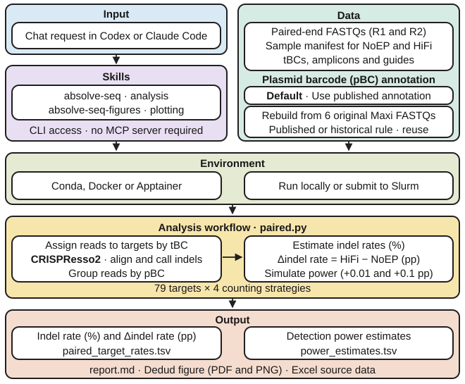

<p align="center">
  <picture>
    <source media="(prefers-color-scheme: dark)" srcset="docs/assets/absolve-seq-agent-dark.png" />
    
  </picture>
</p>

<h1 align="center">Quantify off-target gene editing with ABSOLVE-seq</h1>

<p align="center">
  A conversational analysis agent for the original 79-target reporter panel, available in Codex, Claude Code and DeepSeek Harness.
</p>

<p align="center">
  <a href="#start-with-one-message">💬 <strong>Start in chat</strong></a> &nbsp;·&nbsp;
  <a href="#set-up-your-chat-client">⚙️ Set up a client</a> &nbsp;·&nbsp;
  <a href="#study-panel-results">📊 Read the results</a> &nbsp;·&nbsp;
  <a href="docs/manuscript-reads.md#analyze-all-study-samples">🧬 Full-panel walkthrough</a>
</p>

**What is ABSOLVE-seq?** ABSOLVE-seq (Assessment By Stand-in Off-target LentiViral Ensemble with sequencing) measures insertions and deletions (indels) in reporters carrying reference or variant sequences from candidate CRISPR off-target sites. The agent compares wild-type (WT) and HiFi Cas9 with the NoEP control at each target and estimates the power to detect small increases in editing. [Original study](https://doi.org/10.1101/2024.07.24.605019)

## Example conversations

<a id="from-paired-fastqs-to-a-report"></a>

### Start with one message

Paste the **User** message below into your configured client. The agent can download the 52 public FASTQs (51.7 GB), or use your manifest if you already have the reads. Supplementary Tables 2–5 are optional for comparison with the paper. [Full-panel input guide](docs/manuscript-reads.md#analyze-all-study-samples) · [Verified 26-library run](docs/manuscript-reads.md#new-user-acceptance)

By default, the agent downloads the published plasmid barcode (pBC) annotation and verifies its SHA-256 checksum before building the target index. You only need the original study’s six Maxi FASTQs to rebuild the annotation from scratch. [Download the published pBC annotation](https://raw.githubusercontent.com/pellinlab/ABSOLVE-seq/271355dfe40cf46b952e82b88dd4521f23f9feb4/test/data/plasmid_barcode_category.tsv.gz)

<table>
<tbody>
<tr><td><strong>👤 User · One-message prompt</strong><br>Set up https://github.com/JasonLinjc/ABSOLVE-seq-agent and analyze all 79 targets in all 26 original study libraries from raw FASTQs. Use my configured data or fetch the public reads, including every donor and replicate. For each of the four filtering strategies, compare WT and HiFi separately with NoEP. Report indel rates, differences in percentage points, p-values, adjusted q-values and detection power. Verify the outputs, summarize the findings here, and link the report, complete tables, Figure 3b and its Excel source data.</td></tr>
<tr><td><strong>🤖 Agent · Example result</strong><br>Across 9 NoEP, 9 WT and 8 HiFi libraries from three donors, all three positive controls passed the Dedud thresholds (Δ &gt; 0.1 percentage points and q &lt; 0.05) for both editors versus NoEP. These were the two on-target controls, <code>1450_OT_0000_REF</code> and <code>1617_OT_0000_REF</code>, and the previously validated off-target control, <code>1617_OT_0040_ALT</code>.<br><br>At the off-target control, the estimated indel rate was 0.01% for NoEP, 51.77% for WT and 4.49% for HiFi. One additional target, <code>1450_OT_0071_REF</code>, passed the Dedud thresholds for WT only.<br><br>Open <code>runs/study-panel/results/report.md</code> for the results across all targets and strategies, including detection power and the figure source data.</td></tr>
</tbody>
</table>

<details>
<summary><strong>Try a smaller example or select one matched pair</strong></summary>

<table>
<tbody>
<tr><td><strong>👤 User</strong><br>Run the public D3734/T1 HiFi and NoEP example from FASTQs and show me the report.</td></tr>
<tr><td><strong>👤 User · With local data</strong><br>My FASTQs are in <code>/path/to/fastqs</code> and my sample sheet is at <code>/path/to/sample-sheet</code>. Find the matched HiFi and NoEP pairs. If several are available, let me choose one, then run it through to the report.</td></tr>
</tbody>
</table>

The public pair uses four FASTQs (1.58 GB). [Paired tutorial](docs/d3734-t1-quick-start.md) · [Docker acceptance record](docs/container.md#d3734t1-docker-acceptance)

</details>

<a id="choose-settings-in-chat"></a>
<details>
<summary><strong>Choose a plasmid barcode annotation</strong></summary>

<table>
<tbody>
<tr><td><strong>👤 User</strong><br>I previously generated a plasmid barcode (pBC) annotation for this study. Can I reuse it?</td></tr>
<tr><td><strong>🤖 Agent</strong><br>Yes. Give me the directory where you saved it and I’ll use the rule recorded there. The default is the published annotation. To rebuild it, I can use the original study’s six Maxi FASTQs with the published entropy threshold or the optional historical two-tBC rule.</td></tr>
</tbody>
</table>

[Maxi inputs and build instructions](docs/historical-maxi.md#build-the-reference-once)

</details>

<a id="manuscript-comparison"></a>
<details>
<summary><strong>Reproduce Supplementary Tables 2–5</strong></summary>

<table>
<tbody>
<tr><td><strong>👤 User</strong><br>I have the original 26 libraries and the submitted workbooks. Can you reproduce Supplementary Tables 2–5?</td></tr>
<tr><td><strong>🤖 Agent</strong><br>I’ll use the historical processing for WT, NoEP and HiFi and the historical pBC annotation. I’ll compare the indel rates, editing differences, q-values and positive calls with the workbooks across all 632 contrasts.</td></tr>
</tbody>
</table>

[Historical runtime and inputs](docs/manuscript-reads.md#reproduce-the-submitted-calls-from-the-original-fastqs) · [Full-panel acceptance](docs/historical-panel-acceptance.md)

</details>

<a id="validate-pbc-annotation-reproducibility"></a>
<details>
<summary><strong>Validate pBC annotation reproducibility</strong></summary>

<table>
<tbody>
<tr><td><strong>👤 User</strong><br>Validate pBC annotation reproducibility.</td></tr>
<tr><td><strong>🤖 Agent</strong><br>I’ll compare the published and rebuilt annotations using the saved alignments for all 26 libraries in the configured Luminary archive. I’ll return the summary, field-level differences and SHA-256 manifest.</td></tr>
</tbody>
</table>

[Archive setup and output guide](docs/pbc-validation.md#run-from-codex-or-claude-code)

</details>

<a id="set-up-in-codex-or-claude-code"></a>

## Set up your chat client

Clone the repository and start your client from the checkout.

```bash
git clone https://github.com/JasonLinjc/ABSOLVE-seq-agent.git
cd ABSOLVE-seq-agent
```

| Client | How to start |
| --- | --- |
| Codex | Open the folder in the Codex app or run `codex` in the checkout. Ask for the ABSOLVE-seq skill or type `$absolve-seq` in the CLI. [Codex quick start](https://developers.openai.com/codex/quickstart/) |
| Claude Code | Run `claude` in the checkout and enter `/absolve-seq` followed by your request. [Claude Code quick start](https://code.claude.com/docs/en/quickstart) |
| DeepSeek Harness | Configure the gateway, then send the prompt with the headless CLI. [DeepSeek Harness setup](#configure-deepseek-harness) |

For the analysis runtime, download the prebuilt Linux x86-64 Docker or Apptainer image, or install the locked Conda environment. [Download v0.2.0](https://github.com/JasonLinjc/ABSOLVE-seq-agent/releases/tag/v0.2.0) · [Load and run the image](docs/container.md#download-a-prebuilt-image) · [Conda setup](docs/d3734-t1-quick-start.md#1-get-the-agent-and-create-an-environment)

### Configure DeepSeek Harness

On Luminary, `dsh` reproduced the default full-panel count and model tables byte for byte from raw FASTQs. The power, Figure 3b and Excel checks also passed. [Acceptance record and comparison with the submitted tables](docs/dsh-panel-acceptance.md)

<details>
<summary><strong>Install and configure the tested CLI</strong></summary>

1. From the checkout, install the tested CLI with Node.js 24.9 or later.

   ```bash
   npm install --global @deepseek-ai/dsh@0.2.2-rc.1
   ```

2. Set the base URL and model ID supplied by your OpenAI-compatible DeepSeek gateway. In Bash, the last two lines read and export the API key without displaying it. [Gateway configuration template](examples/dsh-gateway.yml)

   ```bash
   export ABSOLVE_LLM_BASE_URL='https://your-gateway.example/v1'
   export ABSOLVE_LLM_MODEL='your-deepseek-model-id'
   read -rsp 'Gateway API key: ' ABSOLVE_LLM_API_KEY && printf '\n'
   export ABSOLVE_LLM_API_KEY
   ```

3. On the machine that will run the analysis, prepare the [full-panel runtime and inputs](docs/manuscript-reads.md#analyze-all-study-samples). Run the first line below, paste the [one-message prompt](#start-with-one-message), and press Enter. Then run the second line.

   ```bash
   read -rp 'Analysis request: ' study_prompt
   dsh --profile headless --patch examples/dsh-gateway.yml "$study_prompt"
   ```

For a remote cluster, the tested setup used a site-provided MCP server with tools to submit the panel and check its Slurm status. To use your site's bridge from a workstation, add `--patch /path/to/cluster-bridge.yml` before `"$study_prompt"`.

</details>

## How the agent works

<a id="fastq-to-report-workflow"></a>

### Agent architecture

<p align="center">
  
</p>

Supply R1 and R2 for each library. The manifest links each pair to its sample and records the file checksums. [Manifest template](examples/manifest.example.tsv)

In the default workflow, Trimmomatic trims both mates and the target barcode (tBC) assigns each pair to a target. CRISPResso2 merges the mates with FLASH, aligns them to the amplicon and calls indels in the cut-site window. Within each sample and target, the plasmid barcode (pBC) identifies reads from the same family.

The four strategies share the same alignments. The published annotation determines which pBCs qualify by default.

| Strategy | What counts toward the indel rate |
| --- | --- |
| Unfiltered | All aligned reads |
| Dedup | One representative allele per sample, target and pBC |
| Dedud | Reads with a qualifying pBC that pass cross-target filtering |
| Dedud+Dedup | One representative allele per retained pBC family |

## Study panel results

Open **`results/report.md`** inside your run directory. For each target, the model estimates indel rates for NoEP, WT and HiFi, weighting the three donors equally on the logit scale. Δ is the edited rate minus the NoEP rate, in percentage points.

| File in `results/` | What it contains |
| --- | --- |
| `library_counts.tsv` | 8,216 indel counts and denominators (26 libraries × 79 targets × 4 strategies). |
| `panel_comparison.tsv` | 632 contrasts (WT or HiFi versus NoEP). Each row gives the fitted rates, Δ, one-sided p-value, and Benjamini–Hochberg q-value adjusted across 79 targets within that editor and strategy. |
| `power_estimates.tsv` | 1,264 estimates of detection power, one for each contrast at assumed increases of 0.01 and 0.1 percentage points. |
| `figures/Figure3b.pdf` and `figures/Figure3b_source_data.xlsx` | Dedud results for both editors, with 158 target/editor combinations in the figure and workbook. |

Sample identities and processing settings are in `sample_inventory.tsv` and `provenance.json`. [Statistical model and power estimates](docs/power.md)

<a id="paired-results"></a>
<details>
<summary><strong>Results for a single matched pair</strong></summary>

For a single donor and replicate, `paired_target_rates.tsv` gives the observed HiFi and NoEP counts, denominators, indel rates and Δ for all 316 target/strategy combinations. Rates with a zero denominator are undefined. The run also writes 632 power estimates and a Dedud figure with Excel source data under `figures/paired_effect_power.{pdf,png,xlsx}`. [D3734/T1 example](docs/d3734-t1-quick-start.md)

</details>

<a id="figure-3b-and-reproducibility"></a>
<details>
<summary><strong>Redraw the published Figure 3b</strong></summary>

The routine panel figure uses power simulated from the run's counts. To use the original submitted power values, ask for **“Figure 3b with submitted power.”** [Figure 3b commands and verification](docs/manuscript-figures.md)

</details>

<a id="quick-start"></a>

## Run from the terminal

After preparing the runtime, manifest and references, run all 26 libraries from FASTQs with the default paired-end workflow and published pBC annotation. Add `--read-mode historical` only to reproduce Supplementary Tables 2–5. [Full-panel walkthrough](docs/manuscript-reads.md#analyze-all-study-samples)

```bash
python paired.py --manuscript-panel --output runs/study-panel
```

On a workstation the command returns after aggregation. On Slurm, wait for the finish job listed in `runs/study-panel/jobs.json`. Then verify the power table, plotted values and Excel workbook.

```bash
python verify_results.py power runs/study-panel/results
```

<a id="local-inputs-and-caches"></a>
<details>
<summary><strong>Configure local inputs</strong></summary>

`ABSOLVE_DATA` selects the data directory (default `data/` in the checkout). `ABSOLVE_MANIFEST` defaults to `$ABSOLVE_DATA/sample_manifest.tsv`. For the original laboratory files, `python -m tools.resolve_inputs INVENTORY.tsv METADATA.xlsx OUTPUT.tsv` joins both mate filenames from the checksum-verified inventory to the submission workbook’s `SRA_data` sheet.

</details>

## Repository layout

The three main commands live at the top level. Use [setup_references.py](setup_references.py) to prepare the reference data, [paired.py](paired.py) to run the analysis, and [verify_results.py](verify_results.py) to check the results.

| Directory | What you’ll find |
| --- | --- |
| [examples/](examples/) and [docs/](docs/) | Sample manifests, public FASTQ links, walkthroughs and acceptance records |
| [.agents/skills/](.agents/skills/) and [.claude/skills/](.claude/skills/) | Shared analysis and figure instructions, with Claude Code entry points |
| [absolve/](absolve/) | Barcode filtering, target identity, power estimation, figures and reports |
| [panel_report/](panel_report/), [workers/](workers/) and [runtime/](runtime/) | Library and target processing, manuscript panel models and archived workflow components |
| [tools/](tools/) | Optional manifest import, pilot runs and archive audits |

Run optional tools from the checkout root, for example `python -m tools.luminary_pbc --help`. In the v0.2.0 release these utilities are top-level scripts.

The analysis uses a pinned revision of the upstream code and reference assets. [Upstream ABSOLVE-seq repository](https://github.com/pellinlab/ABSOLVE-seq/tree/271355dfe40cf46b952e82b88dd4521f23f9feb4) · [Upstream license](https://github.com/pellinlab/ABSOLVE-seq/blob/271355dfe40cf46b952e82b88dd4521f23f9feb4/LICENSE.md)
