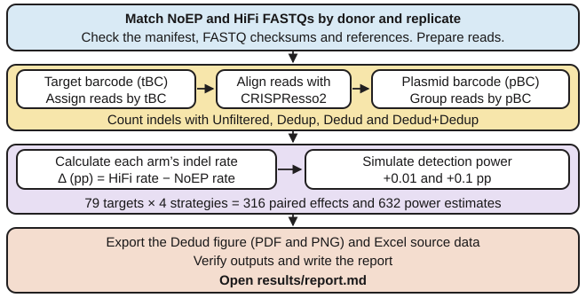

<p align="center">
  <picture>
    <source media="(prefers-color-scheme: dark)" srcset="docs/assets/absolve-seq-agent-dark.png" />
    
  </picture>
</p>

<h1 align="center">From ABSOLVE-seq FASTQs to an indel report</h1>

<p align="center">
  Analyze the original 79-target reporter panel by talking to Codex or Claude Code.<br />
  Run on a workstation or Slurm. Get editing effects, simulated detection power, a report and a figure.
</p>

<p align="center">
  <a href="#start-with-one-message">💬 <strong>Start in chat</strong></a> &nbsp;·&nbsp;
  <a href="docs/d3734-t1-quick-start.md">🧬 Public dataset tutorial</a> &nbsp;·&nbsp;
  <a href="#example-conversations">📖 Example conversations</a> &nbsp;·&nbsp;
  <a href="#figure-3b-and-reproducibility">📊 Figure 3b &amp; Excel</a>
</p>

## Start with one message

**New to the agent?** Open an empty project folder in a signed-in Codex or Claude Code session on a machine with Git and internet access. Paste this message to set up the project **and run the public example**:

> Set up https://github.com/JasonLinjc/ABSOLVE-seq-agent in this empty folder. Follow the public D3734/T1 quick start, prepare the fast-mode environment and references, and download the paired NoEP and HiFi FASTQs. Run all 79 targets with the defaults, verify the results against the public benchmark, and give me the report, power estimates, figure and Excel source data.

This example uses four compressed FASTQs (1.58 GB) from [SRA study SRP722226](https://trace.ncbi.nlm.nih.gov/Traces/?view=study&acc=SRP722226). A completed run produces **316 target/strategy comparisons**. Open `results/report.md` for read retention and a four-strategy summary, or `results/paired_target_rates.tsv` for the counts behind any target.

**Already have original-study FASTQs?** Once the project is set up, give the agent the paths visible on the machine that will run the analysis:

> My FASTQs are in `/path/to/fastqs` and my sample sheet is at `/path/to/sample-sheet`. Find matched HiFi and NoEP samples. If more than one donor/replicate pair is available, ask me which to use. Run the selected pair with the study defaults and return the report, target-level rates, estimated power and figure.

## Set up in Codex or Claude Code

Both skills ship with the repository. To set up manually, clone it and open the checkout in your client.

```bash
git clone https://github.com/JasonLinjc/ABSOLVE-seq-agent.git
cd ABSOLVE-seq-agent
```

| Client | Open the project | Try the analysis skill |
| --- | --- | --- |
| Codex | Open the cloned folder in Codex, or select Codex in the ChatGPT desktop app. For the CLI, run `codex` in the checkout and sign in with ChatGPT. | Type `$absolve-seq` in the CLI, or ask for the skill by name. |
| Claude Code | Run `claude` in the cloned folder and sign in. | Enter `/absolve-seq` followed by your request. |

The clients use the same [analysis instructions](.agents/skills/absolve-seq/SKILL.md) and [Figure 3b instructions](.agents/skills/absolve-seq-figures/SKILL.md). For client installation, see the [Codex quick start](https://developers.openai.com/codex/quickstart/) or [Claude Code quick start](https://code.claude.com/docs/en/quickstart).

<details>
<summary><strong>🔧 Check setup before downloading reads</strong></summary>

Ask: “List the pairs in `examples/manifest.example.tsv` and stop there.” You should see D3734/T1 with `NoEP_pool_D3734_T1` and `HiFi_pool_D3734_T1`. The example manifest contains placeholder paths.

```bash
ABSOLVE_MANIFEST=examples/manifest.example.tsv python paired.py --list
```

After installing the analysis environment, check that CRISPResso reports 2.3.4 and that the model and plotting dependencies load:

```bash
CRISPResso --version
Rscript -e 'stopifnot(requireNamespace("brglm2", quietly=TRUE))'
python -c 'import matplotlib, numpy, openpyxl'
```

For a real run, follow the [reference, manifest and FASTQ setup](docs/d3734-t1-quick-start.md). For the pinned Linux environment, use the [Docker or Apptainer instructions](docs/container.md).

</details>

## How the agent works

<p align="center">
  
</p>

The two skills guide Codex and Claude Code through the repository's command-line tools. The analysis skill runs `paired.py` for a matched pair or a full panel. The figure skill also supports historical Figure 3b redraws. This workflow runs without an MCP server.

**Choose your comparison in chat.** For one donor and replicate, give the agent your FASTQ folder and sample sheet, or ask for the public D3734/T1 example. It matches HiFi with its NoEP control and asks which pair to use if several match. To reproduce the manuscript panel, supply the 26 study libraries and submitted Supplementary Tables 2–5.

<details>
<summary><strong>See the analysis steps for a matched pair and the full panel</strong></summary>

<p align="center">
  
</p>

</details>

**From reads to counts.** The agent runs locally or on Slurm. A pair defaults to fast read processing. The manuscript panel defaults to historical trimming and paired-end alignment. Both modes use the **target barcode (tBC)** to assign each read to a target. Within each sample and target, reads with the same **plasmid barcode (pBC)** form one family. Unfiltered counts reads, Dedup counts one representative allele per family, and Dedud applies the selected plasmid barcode rule and, by default, a cross-target identity check. Dedud+Dedup combines filtering and family counting. The published plasmid barcode annotation from the Maxi pool is the default in both read modes. [Counting strategies](#paired-results) · [Read modes](docs/manuscript-reads.md)

| What you want to do | What to open when the run finishes |
| --- | --- |
| 🧬 **Compare one HiFi sample with its NoEP control** | Start with `results/report.md` for quality checks. In `paired_target_rates.tsv`, each row shows both indel counts, denominators and rates, plus **HiFi minus NoEP** in percentage points. The agent checks for **316 rows** (79 targets × 4 strategies). |
| 📋 **Reproduce the full manuscript comparison** | Provide all 26 libraries and submitted Supplementary Tables 2–5. Open `report.md` for agreement with the manuscript and `panel_comparison.tsv` for **632 comparisons** (WT and HiFi, each versus NoEP), including fitted rates, Δ in percentage points, one-sided p-values and BH-adjusted q-values. |

**How is the editing effect estimated?** For a matched pair, the agent divides each sample’s indel count by its denominator and subtracts the NoEP rate from the HiFi rate. For the manuscript panel, it pools replicate counts within each donor and treatment, then fits a Firth logistic regression for each target and strategy. It averages the three donor-specific logits equally and converts the result to a rate for each treatment. A primary positive call requires an editor-minus-NoEP difference above **0.1 percentage points** and **q < 0.05**. The q-values come from one-sided Wald tests with Benjamini–Hochberg correction across 79 targets within each editor and strategy.

The agent waits for the local run or final Slurm job to finish and checks that each expected comparison appears once. If the inputs and settings match a benchmark profile, it also runs the SHA-256 check on the exported tables before returning the report.

<details>
<summary><strong>Already have counts from a previous panel run?</strong></summary>

`library_counts.tsv` saves one row per sequencing library, target and counting strategy. The `indel` column counts reads or barcode families with an indel, and `denominator` counts all reads or families included under that strategy. The full panel has 26 × 79 × 4 = 8,216 rows.

You can give the agent this table and the submitted references to rerun the statistical model. This skips FASTQ alignment and reuses the barcode filters applied in the earlier run. To test a different barcode rule, regenerate the counts first. [Refit a panel from saved counts](docs/historical-maxi.md#refit-existing-counts)

</details>

📊 **How likely is this design to detect a small increase in editing?** The agent simulates 1,000 experiments per target and strategy at increases of **0.01 and 0.1 percentage points**, using the observed sequencing depths and estimated NoEP background. Power is the fraction of simulated one-sided tests with nominal *p* < 0.05. The report links `power_estimates.tsv`, Monte Carlo intervals, a Dedud figure (PDF and PNG), and Excel source data. A matched pair gets a HiFi–NoEP figure. A full panel gets **Figure 3b with newly estimated power**. [Simulation method, assumptions and outputs](docs/power.md)

## Example conversations

### From paired FASTQs to a report

The first prompt above runs the whole example. To guide it step by step, send these messages in the same chat:

1. **Identify inputs.** “Show me which mates belong to NoEP and HiFi for public D3734/T1. Verify their archive checksums and build my sample manifest.”
2. **Run the pair.** “Use four local workers, fast read processing and the manuscript plasmid barcode rule. Save all four strategies under `runs/D3734-T1` and wait for completion.”
3. **Check a result.** “Compare raw and prepared read pairs in the two arms. Does `1617_OT_0040_ALT` still have a positive difference after Dedud+Dedup? Show the counts.”
4. **Open the report.** “Give me the report, figure, target table and power estimates. Flag undefined rates and tell me whether the D3734/T1 benchmark passed.”

**What a verified answer looks like.** For that target in the public pair, NoEP has **0/1,619** edited pBC families and HiFi has **9/675**. The rates are 0.00% and 1.33%, giving **+1.33 percentage points** for HiFi minus NoEP. You can check both counts in `paired_target_rates.tsv`.

### From the full cohort to a manuscript report

> I have all 26 libraries, their manifest and submitted Supplementary Tables 2–5. Check the historical software versions, run the manuscript workflow and summarize agreement for WT and HiFi by strategy. Estimate power from my counts, draw Figure 3b from the fitted Dedud estimates and simulated power, and return the report, PDF and Excel source data.

If you already have a complete `library_counts.tsv` from a previous panel run, ask the agent to start with a [count refit](docs/historical-maxi.md#refit-existing-counts) and identify that starting point in the report.

## Quick start

Prefer the terminal? Follow the [D3734/T1 walkthrough](docs/d3734-t1-quick-start.md) to install the environment, fetch the pinned upstream references, verify both mates and create the manifest. The public runs are NoEP `SRR39887646` and HiFi `SRR39887695`. The same donor and replicate also have a [WT library](https://www.ebi.ac.uk/ena/browser/view/SRR39887693) for the [full-panel comparison](#manuscript-comparison).

With inputs ready, run the public pair on a workstation:

```bash
python paired.py --donor D3734 --replicate T1 --threads 4 --fresh --output runs/D3734-T1
python verify_results.py pair-fast runs/D3734-T1/results
python verify_results.py power runs/D3734-T1/results
```

Local execution defaults to one worker. Use `--executor local` to select local execution on a host with Slurm tools installed. On a cluster, submit `sbatch paired.sbatch --donor D3734 --replicate T1` from the repository root in the analysis environment.

## Paired results

Each row gives the NoEP and HiFi numerators, denominators, rates (%) and difference (percentage points). A zero denominator leaves the rate blank. The fast workflow also writes `qc.json` and `strategy_summary.tsv` alongside the report.

| Strategy | What counts toward the rate |
| --- | --- |
| Unfiltered | All aligned reads |
| Dedup | One representative allele per sample, target and pBC family |
| Dedud | Reads with a qualifying plasmid barcode that pass cross-target filtering |
| Dedud+Dedup | One representative allele per retained family after filtering |

The default `--maxi-method manuscript` uses the published plasmid barcode (pBC) annotation. The historical method rebuilds membership from six original Maxi FASTQs. [Historical Maxi reference and validation](docs/historical-maxi.md)

<details>
<summary><strong>Compare pBC definitions or change the target filter</strong></summary>

Select `merged` for QC on pooled Maxi reads, or `any-pool`, `two-pools` or `all-pools` to require support from one, two or all three pools. Set `ABSOLVE_MAXI_MERGED` to the merged reference or `ABSOLVE_MAXI_POOLS` to the parent of `LV_Maxi_1`, `LV_Maxi_2` and `LV_Maxi_3`. Each reference needs its `summary.json` and checksum-matched `plasmid_barcode_category.tsv.gz`.

The manuscript cross-target filter requires edited alleles to match the assigned target uniquely by minimum edit distance. Use `--target-filter pbc-only` for earlier barcode-only fast counts. To use the rebuilt reference, select `--maxi-method historical --maxi-reference DIR`. Run each comparison in a separate output directory.

</details>

## Figure 3b and reproducibility

The panel workflow writes `figures/Figure3b.pdf` and `figures/Figure3b_source_data.xlsx` using its fitted effects and freshly simulated power. To reproduce the published graphic, ask for **Figure 3b with submitted power**. The redraw can use submitted or refitted effects while retaining the original Supplementary Table 2 power values. Both versions export 158 plotted target/editor rows and record the power source. [Figure commands and verification](docs/manuscript-figures.md)

The separate benchmark profiles cover a D3734/T1 fast pair, a manuscript-read pair with historical Maxi membership, and a panel refit from saved counts. Run the profile that matches your inputs and settings:

```bash
python verify_results.py pair-fast runs/paired-fast/results
python verify_results.py pair-historical runs/paired-historical/results
python verify_results.py panel-refit runs/panel-refit
```

## Manuscript comparison

The full design covers 26 libraries and 79 targets. D3734/T3 has WT and NoEP without a matched HiFi library. Manuscript read processing uses Trimmomatic 0.36 and paired-end CRISPResso2 2.2.13. [Historical runtime and input setup](docs/manuscript-reads.md)

```bash
python panel_report/references.py /path/to/submitted/workbooks data/submitted_model_reference --full-model
python paired.py --manuscript-panel --read-mode manuscript --output runs/manuscript-replay
```

The manuscript panel fits a Firth binomial regression with treatment and donor, then averages the three donor-specific logits equally for each treatment. A primary call requires Δ > 0.1 percentage points and BH q < 0.05, adjusted across 79 targets per editor and strategy. The fast panel weights donors by observed pBC-family counts.

| Validation starting point | Agreement with submitted primary calls |
| --- | --- |
| Historical-trimming FASTQ replay | 628/632 (four WT differences). [Count-level audit](docs/manuscript-discordance.md) |
| Saved encounter-order counts, equal-donor refit | 632/632. [Refit validation and numerical differences](docs/historical-maxi.md#luminary-acceptance) |

## Local inputs and caches

Keep FASTQs, sample manifests, submitted workbooks and run outputs on storage accessible to the workflow. `ABSOLVE_DATA` selects the data directory, `ABSOLVE_MANIFEST` selects a manifest and `ABSOLVE_CACHE` points to compatible cached alignments. `--fresh` forces a paired run to realign. Use the [manifest template](examples/manifest.example.tsv) for laboratory files, or build it with `python resolve_inputs.py INVENTORY.tsv METADATA.xlsx data/sample_manifest.tsv`.

The analysis uses a pinned revision of the [upstream ABSOLVE-seq repository](https://github.com/pellinlab/ABSOLVE-seq/tree/271355dfe40cf46b952e82b88dd4521f23f9feb4). Its code and reference assets are covered by the [upstream license](https://github.com/pellinlab/ABSOLVE-seq/blob/271355dfe40cf46b952e82b88dd4521f23f9feb4/LICENSE.md).
