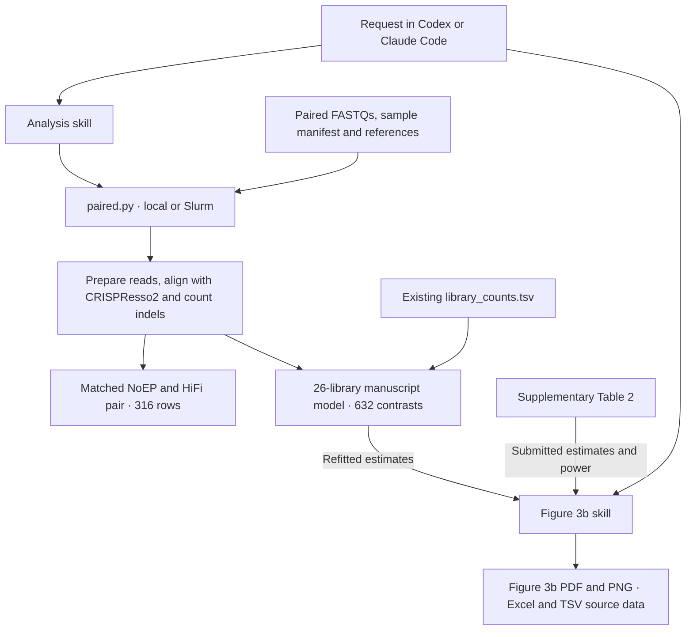

# ABSOLVE-seq agent

ABSOLVE-seq agent measures cut-site indels in the original pooled reporter libraries. Run it from Codex or Claude Code on a workstation or Slurm cluster. Choose a donor, replicate and Maxi plasmid-barcode (pBC) rule to get four indel-rate estimates for every target. The manuscript mode compares WT and HiFi against NoEP across the original 26 libraries and 79 targets.

The analysis is based on the [upstream ABSOLVE-seq repository](https://github.com/pellinlab/ABSOLVE-seq/tree/271355dfe40cf46b952e82b88dd4521f23f9feb4). Read the [upstream license](https://github.com/pellinlab/ABSOLVE-seq/blob/271355dfe40cf46b952e82b88dd4521f23f9feb4/LICENSE.md) for its code and reference assets.

## Set up in Codex or Claude Code

Clone the repository on the workstation or cluster where you want to run the analysis. Both clients use the same checkout, skills and Python workflow. You can try the setup check below with Python 3.10+ and the included example manifest. For a real run, follow the [public-data quick start](docs/d3734-t1-quick-start.md) to install the analysis environment, prepare the references and verify the FASTQs.

```bash
git clone https://github.com/JasonLinjc/ABSOLVE-seq-agent.git
cd ABSOLVE-seq-agent
```

### Codex with a ChatGPT account

1. In the ChatGPT desktop app, sign in, choose **Codex** from the product selector and open the cloned **ABSOLVE-seq-agent** folder. For the terminal interface, install the Codex CLI, run `codex` from the repository root and choose **Sign in with ChatGPT**. [OpenAI quick start](https://developers.openai.com/codex/quickstart/) · [Codex CLI](https://developers.openai.com/codex/cli/)
2. Start a chat in that folder. Codex discovers `absolve-seq` and `absolve-seq-figures` under `.agents/skills/`. In the CLI, type `$` to select either skill. [Codex skill discovery](https://developers.openai.com/codex/skills/)
3. Try this first message in the project chat. **“Use the absolve-seq skill to list the pairs in `examples/manifest.example.tsv`. Stop after listing them.”**

### Claude Code

1. Install Claude Code using the [Claude Code quick start](https://code.claude.com/docs/en/quickstart). From the repository root, run the following setup in Bash or Zsh. It links both skills into Claude Code's project skill directory so that a future `git pull` updates the instructions and plotting script together. [Claude Code project skills](https://code.claude.com/docs/en/skills)

   ```bash
   mkdir -p .claude/skills
   for skill in absolve-seq absolve-seq-figures; do
     if [ ! -e ".claude/skills/$skill" ] && [ ! -L ".claude/skills/$skill" ]; then
       ln -s "../../.agents/skills/$skill" ".claude/skills/$skill"
     fi
   done
   claude
   ```

2. Follow the sign-in prompt on first launch. In the Claude Code chat, enter **`/absolve-seq List the pairs in examples/manifest.example.tsv and stop there.`** For Figure 3b, start a request with **`/absolve-seq-figures`**.

### Check your setup

Either prompt should list **D3734 / T1** with **NoEP_pool_D3734_T1** and **HiFi_pool_D3734_T1**. The example manifest contains placeholder paths. This checks the workflow entry point and pair discovery before downloading reads. You can run the same check directly from the repository root.

```bash
ABSOLVE_MANIFEST=examples/manifest.example.tsv python paired.py --list
```

Once your real manifest and references are ready, try the [example conversations](#example-conversations). The analysis runs where the workflow is launched, so that machine must have access to the input paths. On a workstation without Slurm the Python workflow runs locally.

## How the agent works

Open this repository in Codex or Claude Code and describe the comparison or figure you want. The [analysis skill](.agents/skills/absolve-seq/SKILL.md) translates the request into a donor, replicate, read-processing mode and Maxi pBC rule. It calls the same Python workflow you can run from the command line. The [Figure 3b skill](.agents/skills/absolve-seq-figures/SKILL.md) uses the submitted workbook or a completed panel fit to generate the plot and its source data.



A paired run reports HiFi minus NoEP for each of 79 targets under the Unfiltered, Dedup, Dedud and Dedud+Dedup strategies. The manuscript model compares WT and HiFi separately with NoEP across three donors. Figure 3b uses the model's **Dedud** results and takes target-specific power from Supplementary Table 2 in both plotting modes.

## Example conversations

### Run a public sample and inspect one target

> **User** — I have a workstation and four cores. Run the public D3734/T1 NoEP and HiFi FASTQs from scratch with the default Maxi rule. Verify all four strategies.
>
> **Agent** — I'll use fast read processing, the published manuscript pBC annotation and four local workers. I'll check the 316-row `paired_target_rates.tsv` against the `pair-fast` benchmark.
>
> **User** — For `1617_OT_0040_ALT`, is the difference still positive after Dedud+Dedup? Show the counts behind the rates.
>
> **Agent** — Yes. In the verified D3734/T1 example, NoEP has 0 edited families out of 1,619 (0.00%) and HiFi has 9 out of 675 (1.33%). HiFi minus NoEP is **+1.33 percentage points** for this pair.

The [public-data quick start](docs/d3734-t1-quick-start.md) gives the accessions, file checks and commands for this conversation.

### Change the pBC rule for the same pair

> **User** — I have QC results for all three Maxi pools. Repeat D3734/T1 with `two-pools` and compare it with the default run. Did the Dedud estimate change for `1617_OT_0040_ALT`?
>
> **Agent** — I'll keep the donor, replicate and read mode fixed and write the new run to a separate directory. For that target I'll report the edited counts and denominators in each arm, then compare the two HiFi-minus-NoEP estimates.

### Refit the manuscript panel and export Figure 3b

> **User** — I have the frozen 26-library `library_counts.tsv` and submitted Supplementary Tables 2–5. Refit the manuscript model and tell me how many WT and HiFi calls agree with the supplements.
>
> **Agent** — I'll check the 8,216 count records, fit the equal-donor model and compare the 632 calls by editor and strategy.
>
> **User** — Draw Figure 3b from that refit and give me the underlying Excel table.
>
> **Agent** — I'll use the refitted Dedud estimates and the power values from Supplementary Table 2. The PDF and PNG will share a 158-row source table, one row per target and editor, exported as Excel and TSV alongside input hashes.

See the [count-refit instructions](docs/historical-maxi.md#refit-existing-counts) and the [Figure 3b commands](docs/manuscript-figures.md). To redraw the submitted estimates directly, ask “Reproduce Figure 3b from Supplementary Table 2 and export its Excel source data.”

## Quick start

Use the [Docker or Apptainer container](docs/container.md) for the locked Linux environment, or install the Conda environment below.

Try the agent with public ABSOLVE-seq data from [SRA study SRP722226](https://trace.ncbi.nlm.nih.gov/Traces/?view=study&acc=SRP722226) (BioProject PRJNA1503690). The D3734/T1 example uses just two paired-end runs, NoEP `SRR39887646` and HiFi `SRR39887695`. Follow the [D3734/T1 quick start](docs/d3734-t1-quick-start.md) to download the four FASTQs, verify their archive checksums and export the 316-row comparison.

The same donor and replicate also have a wild-type Cas9 library, [WT SRR39887693](https://www.ebi.ac.uk/ena/browser/view/SRR39887693). The [26-library manuscript workflow](#manuscript-comparison) includes the WT versus NoEP comparison.

Clone this repository and run commands from its root. Activate the analysis environment on your workstation or Linux cluster. With no Slurm allocation and no `sbatch` on PATH, the Python entry point runs synchronously on the local machine. On a cluster use the Slurm submission commands and a shared filesystem.

```sh
conda env create -f environment.yml
conda activate absolve-agent
python paired.py --help
ABSOLVE_MANIFEST=examples/manifest.example.tsv python paired.py --list
```

The example manifest demonstrates pair discovery. For analysis, provide a tab-delimited manifest at `data/sample_manifest.tsv` with absolute R1/R2 paths, their SHA-256 values and the original sample names. The quick start generates this manifest from either the public D3734/T1 files in their ENA filenames or the laboratory files in their original filenames. See the [manifest template](examples/manifest.example.tsv). The workflow checks file identity before processing. If you have the laboratory inventory and SRA submission workbook, generate the manifest with `python resolve_inputs.py INVENTORY.tsv METADATA.xlsx data/sample_manifest.tsv`.

Fetch the public sample table, target definitions and published Maxi annotation from the pinned revision. Indexing writes target-specific files into a new `data/references/` directory.

```sh
mkdir -p data
git clone https://github.com/pellinlab/ABSOLVE-seq.git data/upstream
git -C data/upstream checkout --detach 271355dfe40cf46b952e82b88dd4521f23f9feb4
python setup_references.py
python paired.py --list
```

On a workstation, run the following command after preparing your inputs. Local execution uses one worker by default. Set `--threads` to the number of workers your machine can support. Add `--executor local` to select the local machine explicitly, including on a host with Slurm tools installed.

```sh
python paired.py --donor D3734 --replicate T1 --threads 4 --fresh --output runs/D3734-T1
```

On Slurm, submit the same pair with `sbatch paired.sbatch --donor D3734 --replicate T1`. Local and Slurm runs use the same workers and write the same result tables. For a local Docker run, see the [container example](docs/container.md#docker).

## Paired results

Each completed pair produces `runs/paired_JOBID/results/paired_target_rates.tsv`, with 79 targets × 4 strategies. Each row contains counts, denominators, percent rates and HiFi minus NoEP in percentage points. A rate with a zero denominator is blank. Use `--output DIRECTORY` for a new destination.

| Strategy | Counting unit | Filtering |
| --- | --- | --- |
| Unfiltered | Aligned reads | All aligned families |
| Dedup | One representative allele per sample–target–pBC | Most frequent allele, with top ties resolved by first occurrence |
| Dedud | Aligned reads | Good pBC and cross-target identity check |
| Dedud+Dedup | One representative per retained family | Select the representative after filtering |

The default `--maxi-method manuscript` uses the published pBC annotation. Edited alleles must match the assigned target uniquely by minimum edit distance across the panel. Use `--target-filter pbc-only` to replay the earlier barcode-only counts. The four QC-based alternatives use locally supplied QC outputs. Select `--maxi-method historical --maxi-reference DIR` to use a verified reference rebuilt from all six original Maxi FASTQs. [Build and use the historical reference](docs/historical-maxi.md)

| Maxi method | Evidence for a Good pBC |
| --- | --- |
| `merged` | QC of pooled Maxi reads |
| `any-pool` | Pass in at least one independent pool |
| `two-pools` | Pass in at least two independent pools |
| `all-pools` | Pass in all three independent pools |

Set `ABSOLVE_MAXI_MERGED` to the merged reference directory and `ABSOLVE_MAXI_POOLS` to the parent of `LV_Maxi_1`, `LV_Maxi_2` and `LV_Maxi_3`. Each reference requires `summary.json` and its checksum-matched `plasmid_barcode_category.tsv.gz`. For example, submit `sbatch paired.sbatch --donor D3742 --replicate T2 --maxi-method two-pools --min-exact-reads 3`.

## Figure 3b and reproducibility

Use the [Figure 3b skill](.agents/skills/absolve-seq-figures/SKILL.md) to export the manuscript Dedud panel, its 158-row Excel source table, plotted TSV and provenance. The [Figure 3b guide](docs/manuscript-figures.md) covers the submitted workbook and the agent refit.

For the original study benchmarks, compare your exports against the accepted table hashes. Each command exits with a nonzero status on a mismatch. The paired profiles use D3734/T1 with the documented fast defaults or manuscript reads with the historical Maxi rule. The panel profile uses the frozen 8,216-cell encounter-order count table and the locked statistical environment.

```bash
python verify_results.py pair-fast runs/paired-fast/results
python verify_results.py pair-historical runs/paired-historical/results
python verify_results.py panel-refit runs/panel-refit
```

## Manuscript comparison

For original paired-end processing, configure Trimmomatic 0.36 and the CRISPResso2 2.2.13 image as described in the [manuscript read-mode guide](docs/manuscript-reads.md). Provide the submitted files `SupplementaryTable2.xlsx` through `SupplementaryTable5.xlsx` and all 26 original libraries. The sample design includes the WT and NoEP libraries for D3734/T3, which has no matched HiFi library.

```sh
python panel_report/references.py /path/to/submitted/workbooks data/submitted_model_reference --full-model
python paired.py --manuscript-panel --read-mode manuscript --output runs/manuscript-replay
```

The manuscript panel fits a Firth binomial regression with treatment and donor. For each treatment, it averages the three donor-specific logits with weight 1/3 each and converts the mean back to a probability. Δ is the edited treatment rate minus the NoEP rate, in percentage points. The one-sided Wald test uses the treatment coefficient, with BH correction across 79 targets per editor and strategy. A hit requires Δ above 0.1 percentage points and q below 0.05. The fast panel uses the observed pBC-family counts to weight donors.

| Output under the manuscript run’s `results/` directory | Contents |
| --- | --- |
| `comparison_summary.tsv` | Threshold agreement for each strategy and editor |
| `panel_comparison.tsv` | 632 comparisons with agent and submitted rates, differences, p and q |
| `model_field_comparison.tsv` | 57 submitted model fields per target and strategy |
| `library_counts.tsv` | Per-library counts before and after cross-target filtering |
| `donor_weights.tsv`, `sample_inventory.tsv`, `provenance.json` | Marginalization weights, library inventory and source hashes |

The historical-trimming manuscript panel agreed with the submitted tables on **628 of 632 calls** on Luminary. All 26 libraries matched their archived trimming counts. The fresh replay restored agreement for `1617_OT_0041_REF` (Dedup, HiFi), leaving four WT discrepancies and introducing none. See the [full-panel validation](docs/manuscript-reads.md#luminary-validation) and the [count-level audit](docs/manuscript-discordance.md).

## Local inputs and caches

`ABSOLVE_DATA` overrides the default `data/` directory. `ABSOLVE_MANIFEST` selects an individual manifest. `ABSOLVE_CACHE` can point to a compatible historical deployment containing paired or WT alignment provenance. With fresh inputs the agent prepares and aligns libraries with CRISPResso2. Allow sufficient working disk space for the FASTQs and intermediate alignments. On a single pair, `--fresh` forces realignment. `Rscript` must find `brglm2` through the active environment or `R_LIBS_USER`.

The upstream reference, sample manifest, FASTQs, submitted workbooks and run outputs live outside version control. The scripts in `panel_report/` also support inspecting historical matched cohorts, including pBC family tracing; the archived-cohort audit scripts expect the original provenance and alignment layout.
